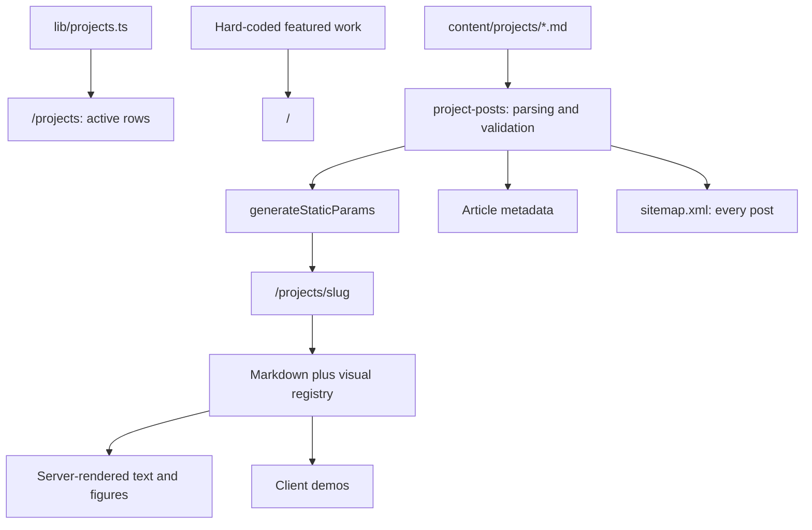

# Codebase architecture review

Reviewed: October 1, 2026.

This portfolio has an appropriate architectural foundation for a solo-maintained content site. Next.js renders the main pages ahead of time, Markdown keeps writing close to the code, and interactive components are mostly isolated. The highest-value improvements are explicit publishing rules, stronger content validation, accessible mobile presentation, and automated checks. A framework rewrite or CMS migration would add cost without addressing those problems.

## Scope and evidence

The review covered application routes, components, utilities, all five journal files, styling, package/configuration files, and the existing architecture decision record. Findings distinguish observed behavior from risks inferred from source code.

| Check | Result |
| --- | --- |
| `npm run lint` | Passed with no reported warnings or errors. |
| `npm run build` | Passed, including TypeScript checking and static generation. The first sandboxed attempt failed because Turbopack could not bind a local port; the authorized retry succeeded. |
| Generated route inventory | Five journal pages are generated, including two mock posts and the inactive component-library listing. |
| Generated HTML metadata | Inspected Shopify, visual regression, and portfolio-site pages. Visual regression uses its generated image URL; the other two use the portrait fallback. |
| Automated test / CI inventory | No tracked test suite or GitHub Actions workflow found. External deployment checks were not inspected. |

This was a source and build review, not a browser accessibility audit, performance benchmark, dependency vulnerability audit, or production configuration inspection. No production defect is inferred solely from local environment settings. Only this report was added; the pre-existing untracked lesson-progress document was left unchanged.

## How the application works

| Area | Responsibility |
| --- | --- |
| [`app/layout.tsx`](../app/layout.tsx) | Shared header/footer, fonts, global styles, analytics, and default metadata. |
| [`app/page.tsx`](../app/page.tsx) | Homepage, selected work, experience, and toolkit. Featured project copy is embedded here. |
| [`app/projects/page.tsx`](../app/projects/page.tsx) | Renders active entries from `PROJECT_GROUPS`. |
| [`lib/projects.ts`](../lib/projects.ts) | Typed listing data, including company, period, links, summary, and optional `active`. |
| [`lib/project-posts.ts`](../lib/project-posts.ts) | Reads Markdown from disk, parses frontmatter, checks fields, and enumerates slugs. |
| [`app/projects/[slug]/page.tsx`](../app/projects/[slug]/page.tsx) | Generates journal routes and metadata, renders Markdown, and inserts custom case-study figures. |
| [`app/experiments/page.tsx`](../app/experiments/page.tsx) | Static experiment announcement. The canvas component is not currently mounted. |
| [`app/globals.css`](../app/globals.css) | Semantic design tokens, typography, layout utilities, focus styling, and motion preferences. |
| [`app/sitemap.ts`](../app/sitemap.ts), [`app/robots.ts`](../app/robots.ts) | Search discovery, using the origin resolved by `lib/site-url.ts`. |



There is no database, authentication layer, or runtime content API. The build prerenders the homepage, index, experiments page, and journal pages. The Open Graph image endpoint is dynamic in the observed build.

Listing data and articles intentionally serve different purposes. [ADR 0001](adr/0001-projects-journal-and-listings.md) explains why index-only entries must remain possible. Preserve that flexibility, while enforcing the relationship between entries that do link to articles.

Client code supports navigation state, clipboard feedback, a local clock, haptics, portrait interaction, mobile toolkit highlighting, and interactive case-study demos. Static figures remain Server Components. That is a sensible division, though the shared header and footer can eventually contain smaller interactive leaves.

## What already works well

- Strict TypeScript and a clean lint/build baseline provide a useful foundation.
- Missing posts trigger `notFound()`, and direct slug reads reject traversal-like input.
- Required frontmatter fields are checked rather than blindly trusted.
- Markdown rendering does not enable raw HTML. Custom visuals come from a finite registry.
- Semantic color tokens and shared typography reduce styling drift.
- Focus styles, motion preference handling, labeled controls, clipboard announcements, and observer/timer cleanup are already present.
- Static generation and repository-owned content fit the site's size and editing frequency.

## Prioritized findings

Priority means recommended implementation order. P1 affects currently shipped content or readability; P2 improves correctness and maintainability; P3 is measured cleanup. Effort estimates assume one engineer familiar with the repository and are approximate.

| Priority | Finding | Evidence and impact | Recommended change | Effort |
| --- | --- | --- | --- | --- |
| P1 | Publication and listing visibility are different but not explicitly modeled | `entry.active` only gates index rows. All Markdown files feed route generation and the sitemap. Mock copy and an inactive entry are publicly generated. | Add article publication status and use one published-post selector across routes, metadata, and sitemap. Keep listing visibility separate. | 1 day |
| P1 | Mobile toolkit text has insufficient contrast | `HowTechList.tsx` applies `text-neutral-300` to every inactive mobile item on white. Source token calculation gives approximately 1.48:1. | Keep all meaningful text readable; indicate the active item through weight, marker, or another treatment. | Half day |
| P2 | Content integrity is only partially enforced | Date parsing occurs during enumeration, not direct post parsing. Listing references and local media existence are not validated. | Centralize validation and introduce a content-check command. | 1 day |
| P2 | Markdown extension logic can misinterpret content | Regex insertion operates before Markdown parsing, and splits the article into independent Markdown documents. | Parse markers structurally, or strictly constrain and validate the current convention. | 1 to 2 days |
| P2 | Social image implementation is misleadingly generic | `[slug]/opengraph-image.tsx` ignores the slug and always describes visual regression. Other observed article previews use a small portrait fallback. | Make generated cards post-aware and establish one image-selection policy. | Half to one day |
| P2 | No repository test or CI safety net | Lint/build pass but cannot catch mock publication, mobile contrast, or incorrect preview state. | Add focused content tests, browser smoke tests, and automated gates. | 1 to 2 days |
| P2 | Shared data and route rendering are becoming coupled | Homepage project copy duplicates listing/article information; the article route imports and dispatches all custom figures. | Reuse project identities and move Markdown rendering and visual registration out of the route. | 1 day |
| P3 | Navigation workaround has fragile state | Scroll coordination uses unguarded session storage and a flag consumed only on pathname changes. | Simplify to native navigation behavior where possible; otherwise scope and guard transient state. | Half day |
| P3 | Build and maintenance documentation have drifted | Node version is not pinned; no tracked environment example exists; client boundaries and unused packages have evolved. | Document reproducible setup and remove verified unused dependencies separately. | Half day |

### 1. Establish an explicit publication boundary

The build includes `/projects/portfolio-site` and `/projects/internal-tooling-sprint`, whose bodies explicitly identify themselves as mock content. It also includes `/projects/axonify-component-library`, despite `active: false` in the listing. The sitemap includes all five articles. This is confirmed local output, not merely a hypothetical orphan-link issue.

`active?: boolean` is also ambiguous: omitting it hides the row because the page tests `entry.active` directly. The type allows an omission that silently changes visibility.

Use separate concepts: required article `status: 'draft' | 'published'`, explicit listing visibility, and an optional featured order. Drafts should be excluded from `generateStaticParams` and the sitemap, and direct requests should also return 404. Filtering static parameters alone is insufficient as a publication policy. Keep genuinely private assets outside `public/`, because article status does not restrict static asset URLs.

Acceptance: both mock articles are absent from production routes and sitemap; direct draft requests return 404; hiding a published article from the index remains an intentional, separately documented operation.

### 2. Make validation consistent across every consumer

In `lib/project-posts.ts`, `assertPostFrontmatter()` checks that `date` is a nonempty string, while `getAllSlugs()` performs `Date.parse()`. Consequently, `getPostBySlug()` can return a post whose date fails the enumeration path. `Date.parse()` alone also does not enforce the documented ISO format.

Validate and normalize dates in the parser, then let all readers consume the same validated object. Apply the same safe filename policy during enumeration and direct reads. Specify a display timezone in `formatDisplayDate()` so timestamps near midnight do not change their displayed day with the build host timezone.

A content validator should check publication status, required fields, article references, local image/video paths, and visual identifiers. Account for generated media endpoints such as `/opengraph-image`, rather than treating every URL as a public file. Current listed article references resolve; missing-link risk is a missing guard, not an observed broken listing.

Keep the initial implementation small. A shared parser with explicit checks is sufficient at this scale; a schema library is optional.

### 3. Preserve Markdown semantics when inserting visuals

`renderPostContent()` scans raw source for `<!-- case-study-visual:... -->` and renders each surrounding fragment independently. A marker inside a fenced code example would still be interpreted as a real visual. Reference links defined on the other side of a visual can lose their definitions because the fragments are separate documents. `splitLeadSection()` likewise searches raw text for a heading pattern rather than a parsed heading.

There is also an inconsistency: lead content uses plain `ReactMarkdown`, so visual markers placed there do not follow the body renderer's behavior.

Extract `ProjectMarkdown` and the visual registry first. Then recognize standalone marker nodes in the Markdown syntax tree and transform only those nodes. Preserve whole-document reference definitions and process lead/body consistently. A move to MDX is unnecessary unless authors need broader embedded-component capabilities.

Acceptance: markers in code blocks remain text; reference links work across figures; unsupported visual names produce a clear error naming the source file.

### 4. Unify social previews and metadata policy

The generated image handler uses the visual-regression title, company, and labels for every slug. However, the generated HTML inspected during this review does **not** show the wrong card on Shopify: it explicitly points to `/profile.jpeg`. Visual regression explicitly points to its generated endpoint. Treat the handler as a latent correctness problem and the portrait fallback as a current presentation limitation, rather than claiming all article previews are presently wrong.

Make the handler read the requested published post, and have both Open Graph and Twitter metadata use that post's chosen image. Verify actual generated tags as well as the image itself. Next.js documents file-based image endpoints and metadata resolution in its [image convention reference](https://nextjs.org/docs/app/api-reference/file-conventions/metadata/opengraph-image) and [metadata reference](https://nextjs.org/docs/app/api-reference/functions/generate-metadata); the installed version's output remains the evidence for this review.

Other metadata improvements: supply experiments-specific social title/description instead of inheriting the homepage values; move search verification into the metadata configuration; validate the canonical origin as an HTTP(S) URL; and use an editorial `updated` value when available instead of publishing a new sitemap modification time on every build. The observed localhost URLs are expected for this local build and do not prove production is misconfigured.

### 5. Close accessibility and interaction gaps

The mobile toolkit uses `oklch(87% 0 0)` on white, approximately 1.48:1. Even large text needs at least 3:1, while ordinary text needs 4.5:1 under [WCAG contrast guidance](https://www.w3.org/WAI/WCAG21/Understanding/contrast-minimum). This finding comes from the source palette, not a full rendered-page audit.

Add a skip-to-content link and a consistent main target. The header contact action can be a real `href="#footer"` link with optional haptics, preserving basic navigation without JavaScript. Offer a `mailto:` link alongside clipboard copying.

Two demo details deserve focused verification. The text-field demo switches `defaultValue` based on its state selector, but an uncontrolled input's current value does not reliably reset when that prop changes, particularly after typing. Use explicit state if selecting Error is intended to show an empty field. The visual-regression example is entirely hidden below `md`; provide a compact static or stacked equivalent if that explanation is important to mobile readers. Its button also includes competing background utilities when color changes; express exactly one selected background class.

### 6. Keep performance work proportional to evidence

No measured page-speed or bundle-size regression was established. Avoid treating large source files or Server Component imports as proof of a large client download.

Useful next measurements are route-level JavaScript size, layout shift, font transfer, and mobile image/video loading. The public directory is approximately 16 MB on disk, but that is not the payload of any one page. Some large video/source assets warrant a usage inventory before deletion.

Potential improvements include reserving image dimensions in Markdown, reducing the mobile toolkit's eight observers to one shared observer, and isolating the footer clock/copy controls and header haptics into smaller client components. A visually hidden demo is not automatically excluded from JavaScript loading; measure before adding lazy loading. Font fetching during builds is another reason to consider local font files if offline or deterministic builds become important.

## Suggested target structure

Keep the current application and content model, introducing a few clear boundaries:

```text
app/                             Route composition and metadata
components/site/                 Shared shell and small client controls
components/projects/             Project rows and ProjectMarkdown
components/projects/visuals/     Case-study figures and registry
lib/content/                     Parsing, publication rules, validation
lib/projects.ts                  Listing and featured-project configuration
content/projects/                Authored Markdown
scripts/                         Content validation entry point
```

Move files as related changes are made. Avoid a broad directory-only refactor. Preserve curated homepage wording where it serves a different purpose, while centralizing identities, destinations, publication state, and default titles.

The article route should compose a validated post, shared metadata builder, optional hero, and Markdown renderer. It should not own the details of every case-study illustration. Synchronous file reads are acceptable for five build-time articles; centralizing the loader matters more than introducing a cache or asynchronous data layer now.

## Delivery plan and verification

| Stage | Deliverable | Completion evidence |
| --- | --- | --- |
| 1: Correct public output | Publication rules, removal of mock output, mobile text contrast, deliberate social-image policy | Draft URLs return 404; sitemap contains only intended articles; generated metadata and cards match each article; contrast meets thresholds. |
| 2: Protect content changes | Shared validation, content-check script, focused automated checks | Invalid dates, missing references/assets, and unknown visuals fail with actionable errors; lint/build run in CI. |
| 3: Simplify authoring | Extracted renderer/registry, shared project identities, updated documentation | A new ordinary article requires content/configuration changes without editing route logic. |
| 4: Measure and polish | Browser accessibility pass, performance measurements, targeted client/media cleanup | Keyboard/mobile checks pass; before/after measurements justify any optimization. |

Start tests with content validity and publication behavior, since these cover the strongest demonstrated risks. Add browser smoke checks for navigation, unknown/draft URLs, clipboard failure feedback, and demo state transitions. Use a small number of representative mobile/desktop screenshots and accessibility checks rather than snapshotting every implementation detail.

Document a supported Node version, use `npm ci` in automation, and commit a safe environment example. A local `.env.example` exists, but it is not tracked, and `.gitignore` ignores `.env*`. Update the README's outdated directory map and the agent guide's client-component inventory. Review unused `rehype` and Font Awesome dependencies; the global Font Awesome stylesheet is still imported, so remove that usage deliberately if retiring the package family. Preserve the unfinished dot-field work as intentional work in progress.

The first three stages are roughly several focused engineering days, depending on review and content decisions. They improve the existing design without introducing services, a general-purpose design system package, or a new publishing platform.
