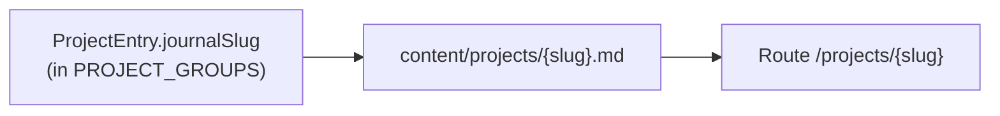

# Project Reference

Descriptive facts about the repository as it is today. Rules live in
`.specify/memory/constitution.md`; this file is updated freely whenever the code changes, with no
version bump.

## Summary

Personal portfolio site built with the Next.js App Router. The project index lives at `/projects`;
long-form journal write-ups live at `/projects/[slug]` and are sourced from Markdown files on disk.

## Stack (current versions)

- Next.js 16.x (`next` 16.1.1), React 19.x, TypeScript strict
- Tailwind CSS 4 with `@tailwindcss/postcss` (see `postcss.config.mjs`) and `@tailwindcss/typography`
- Markdown: `react-markdown`, `remark-gfm`, `gray-matter`
- Icons and analytics: `@fortawesome/react-fontawesome` (+ free icon packs), `@vercel/analytics`
- SVG as React components: `@svgr/webpack` (wired in `next.config.ts` for Turbopack and webpack)
- Audio and haptics (client-only, in `ThemeToggle` and `Header`): `use-sound`, `web-haptics`
- Class names: `clsx`, `tailwind-merge` (via `lib/cn.ts`)

## Commands

- `npm run dev`: development server
- `npm run build`: production build
- `npm run start`: production server (after `npm run build`)
- `npm run lint`: ESLint (there is no test runner in this repo)

## Repository map

- `app/`: routes, `layout.tsx` (root metadata), `globals.css`, `fonts.ts`, `sitemap.ts`, `robots.ts`
- `components/`: UI; most files are Server Components
- `components/assets/`: SVGs imported via `@assets/*` (`tsconfig.json` path alias)
- `lib/`: `projects.ts` (listing data), `project-posts.ts` (Markdown I/O), `cn.ts`, `site-url.ts`
- `content/projects/`: journal `.md` files (one per slug)
- `public/`: static assets; journal media under `public/projects/{slug}/`
- `docs/`: plans, ADRs, design tokens, case studies

To list Client Components, run `grep -rl "use client" app components lib`.

## Content model details

- `lib/projects.ts` exports `PROJECT_GROUPS` and the `ProjectEntry` type. On
  `app/projects/page.tsx`, the row title links to `/projects/{journalSlug}` when `journalSlug` is
  set (otherwise `href` or plain text per row logic).
- `lib/project-posts.ts` reads `content/projects/*.md` with `gray-matter`. Invalid dates throw at
  build or read time. `getAllSlugs()` returns slugs sorted by `date` descending.
- `app/projects/[slug]/page.tsx` exports `generateStaticParams()` from `getAllSlugs()`; a missing or
  invalid post triggers `notFound()`.

## Markdown authoring notes

- Reference post media as `/projects/{slug}/your-file.png`.
- Until per-post art exists, mocks may use existing site assets (for example `/profile.jpeg`).
- The post page maps internal links to `next/link` and external links to anchors with
  `target="_blank"` and `rel="noopener noreferrer"` via custom `react-markdown` components in
  `app/projects/[slug]/page.tsx`.
- The article wrapper uses `@tailwindcss/typography` `prose` utilities.

## SEO details

- `resolveSiteUrl()` prefers `NEXT_PUBLIC_SITE_URL` (trailing slashes stripped), then
  `https://${VERCEL_URL}`, then `http://localhost:3000`.
- It feeds `metadataBase` in `app/layout.tsx` and absolute URLs in `app/sitemap.ts` and
  `app/robots.ts`.
- Root layout sets default title, description, Open Graph, and Twitter metadata. The projects page
  sets `alternates.canonical: '/projects'`.

## Styling details

- `app/globals.css` uses `@import "tailwindcss"` and `@plugin "@tailwindcss/typography"`.
- `@theme` / `@theme inline` bridge CSS variables (`--background`, `--foreground` on `:root`) into
  Tailwind; `--content-container-max-width` drives layout width.
- Utilities in `@layer components`: `.content-container`, `.section__paragraph`, `.fade-up`,
  `.section-grid`, and others.
- Custom breakpoints: `xs` (460px), `layout` (900px).
