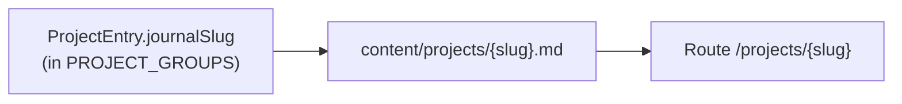

# Project Reference

Descriptive facts about the repository as it is today. Rules live in
`.specify/memory/constitution.md`; this file is updated freely whenever the code changes, with no
version bump.

## Summary

Personal portfolio site built with the Next.js App Router. The project index lives at `/projects`;
long-form journal write-ups live at `/projects/[slug]` and are sourced from Markdown files on disk.

## Stack (current versions)

- Next.js 16.x (`next` 16.1.1), React 19.x, TypeScript strict
- Tailwind CSS 4 with `@tailwindcss/postcss` (see `postcss.config.mjs`) and `@tailwindcss/typography`
- Markdown: `react-markdown`, `remark-gfm`, `gray-matter`
- Icons and analytics: `@fortawesome/react-fontawesome` (+ free icon packs), `@vercel/analytics`
  (`@vercel/analytics` was kept by the maintainer on 2026-10-29 as a free-plan tool under Principle IX;
  if its plan ever asks for payment, remove it)
- SVG as React components: `@svgr/webpack` (wired in `next.config.ts` for Turbopack and webpack)
- Audio and haptics (client-only, in `ThemeToggle` and `Header`): `howler` (loaded on first intent with
  the toggle, never on page load), `web-haptics`
- Performance: `@lhci/cli` (dev, Lighthouse CI, free and open source)
- Class names: `clsx`, `tailwind-merge` (via `lib/cn.ts`)

## Commands

- `npm run dev`: development server
- `npm run build`: production build
- `npm run start`: production server (after `npm run build`)
- `npm run lint`: ESLint (also enforces import alias, `import type`, trailing commas)
- `npm run check:content`: validates the content model (`scripts/check-content.mts`, needs Node
  22.18+ for built-in TypeScript stripping)
- `npm run perf:measure`: builds, serves the production build, measures every public page (3 runs,
  mobile) and fails if any page is over budget. Needs Chrome installed locally.
- `npm run perf:collect`: same measurement without assertions (used to record a baseline)
- `npm run perf:report`: median table from the last run in `.lighthouseci/`; add
  `-- --write docs/performance-baseline.md` to record it
- There is no test runner in this repo
- CI: `.github/workflows/ci.yml` runs `quality-gates` (lint, check:content, build) and `performance`
  (Node 22). `engines.node` is `>=22.18`.

## Repository map

- `app/`: routes, `layout.tsx` (root metadata), `globals.css`, `fonts.ts`, `sitemap.ts`, `robots.ts`
- `components/`: UI; most files are Server Components
- `components/assets/`: SVGs imported via `@assets/*` (`tsconfig.json` path alias)
- `lib/`: `projects.ts` (listing data), `project-posts.ts` (Markdown I/O), `cn.ts`, `site-url.ts`
- `content/projects/`: journal `.md` files (one per slug)
- `public/`: static assets; journal media under `public/projects/{slug}/`
- `docs/`: plans, ADRs, design tokens, case studies

To list Client Components, run `grep -rl "use client" app components lib`.

## Content model details

- `lib/projects.ts` exports `PROJECT_GROUPS` and the `ProjectEntry` type. On
  `app/projects/page.tsx`, the row title links to `/projects/{journalSlug}` when `journalSlug` is
  set (otherwise `href` or plain text per row logic).
- `lib/project-posts.ts` reads `content/projects/*.md` with `gray-matter`. Invalid dates throw at
  build or read time. `getAllSlugs()` returns slugs sorted by `date` descending.
- `app/projects/[slug]/page.tsx` exports `generateStaticParams()` from `getAllSlugs()`; a missing or
  invalid post triggers `notFound()`.

## Markdown authoring notes

- Reference post media as `/projects/{slug}/your-file.png`.
- Until per-post art exists, mocks may use existing site assets (for example `/profile.jpeg`).
- The post page maps internal links to `next/link` and external links to anchors with
  `target="_blank"` and `rel="noopener noreferrer"` via custom `react-markdown` components in
  `app/projects/[slug]/page.tsx`.
- The article wrapper uses `@tailwindcss/typography` `prose` utilities.

## SEO details

- `resolveSiteUrl()` prefers `NEXT_PUBLIC_SITE_URL` (trailing slashes stripped), then
  `https://${VERCEL_URL}`, then `http://localhost:3000`.
- It feeds `metadataBase` in `app/layout.tsx` and absolute URLs in `app/sitemap.ts` and
  `app/robots.ts`.
- Root layout sets default title, description, Open Graph, and Twitter metadata. The projects page
  sets `alternates.canonical: '/projects'`.

## Styling details

- `app/globals.css` uses `@import "tailwindcss"` and `@plugin "@tailwindcss/typography"`.
- `@theme` / `@theme inline` bridge CSS variables (`--background`, `--foreground` on `:root`) into
  Tailwind; `--content-container-max-width` drives layout width.
- Utilities in `@layer components`: `.content-container`, `.section__paragraph`, `.fade-up`,
  `.section-grid`, and others.
- Custom breakpoints: `xs` (460px), `layout` (900px).

## Performance budget

- Limits live in `performance-budget.json`: score at least 0.95, simulated LCP at most 3,000 ms, CLS at
  most 0.1, Total Blocking Time at most 200 ms (the lab stand-in for INP). Real visitors' Google
  thresholds (p75 LCP 2.5 s, INP 200 ms, CLS 0.1) are targets that nothing monitors; spot-check them
  for free with PageSpeed Insights when the site has enough traffic.
- `lighthouserc.cjs` builds the page list (`/`, `/projects`, `/experiments`, and every file in
  `content/projects/`), runs 3 times per page on the mobile profile, and asserts the median. A missing
  or partial result fails the run.
- **Exceptions**: an `exceptions` entry in `performance-budget.json` needs a `path` of a measured page
  and a non-empty `reason`, and its limits are that page's measured values. Current exceptions: none.
- CI posts the median table to the job summary and uploads `.lighthouseci/` as the `lighthouse-results`
  artifact.
- The recorded baseline and the post-fix results are in `docs/performance-baseline.md`.
